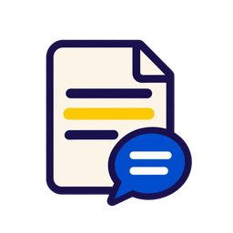

<p align="center">
  
</p>

# Paper Talk Annotator

一个用于论文精读的 Codex skill。给它一篇论文 PDF，它会先读全文并核对关键方法，再写带原文定位的组会讲稿，最后把讲稿里的解释落到原文旁边。

## 交付内容

- **组会讲稿**以可编辑 DOCX 交付，包含能直接讲的正文，以及 PDF 页码、图表号和导读编号。
- **批注 PDF**保留原论文的正文与图表，在同页右侧直接显示完整解读。每条写明所读小节、图表或原词，并解释具体方法、关键比较与结论边界。页边文字是可编辑的 PDF 批注。

## 在 Codex 中使用

克隆本仓库并在 Codex 中打开仓库根目录。也可以把整个 [skill 目录](.agents/skills/paper-talk-annotator)复制到自己的项目的 `.agents/skills/` 下。

附上论文 PDF 后输入：

```text
$paper-talk-annotator 精读附件，生成约 15 分钟的组会讲稿，并在 PDF 同页右侧写出具体的图表和方法解读。
```

可以同时指定输出目录、演讲时长或希望深讲的图表。另附一篇人工批注样稿时，说明它是参考样稿，并指出哪篇是目标论文。

## 本地依赖

辅助脚本使用 Python 3.11+。Codex 桌面可优先使用内置工作区依赖；其他环境可在项目虚拟环境安装：

```sh
python -m pip install pypdf pdfplumber reportlab python-docx
```

PDF 旁注需要可嵌入的 TrueType 字体。最终检查使用 Poppler 和可用的 DOCX 渲染工具。扫描页需要本地 OCR 或按渲染图定位，旋转页和特殊裁切页需要支持相应坐标的 PDF 工具。

具体输入格式、命令和检查步骤见[工作流说明](.agents/skills/paper-talk-annotator/references/artifacts.md)。
